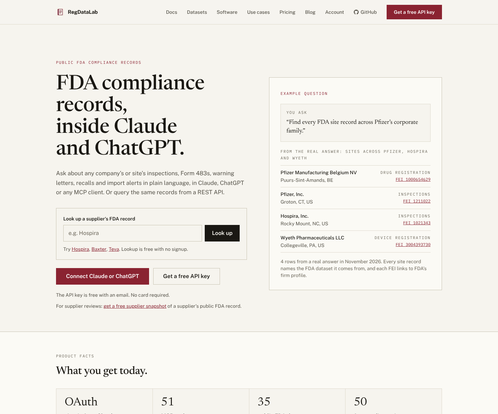

# RegDataLab MCP server (fda-data-mcp)

Public FDA compliance records (inspections, Form 483s, warning letters, recalls) linked by company and site, for Claude, ChatGPT, any MCP client or API.

This is the public install and discovery repo for **RegDataLab – FDA Compliance Data**, the hosted MCP server at https://www.regdatalab.com/mcp. It has 51 read-only tools over 35 public FDA datasets, and every record links back to its FDA source. The npm package keeps the name `fda-data-mcp`. The private backend, ingestion system, and production data pipeline are not open-sourced here.

[](https://www.regdatalab.com)
[](https://www.regdatalab.com/connect.md)
[](https://registry.modelcontextprotocol.io/v0/servers?search=io.github.medley/fda-data)



## Quick Links

- Website: [regdatalab.com](https://www.regdatalab.com)
- MCP endpoint: `https://www.regdatalab.com/mcp`
- Discovery metadata: [`https://www.regdatalab.com/.well-known/mcp.json`](https://www.regdatalab.com/.well-known/mcp.json)
- Connect guide: [regdatalab.com/connect.md](https://www.regdatalab.com/connect.md)
- Product docs: [regdatalab.com/docs](https://www.regdatalab.com/docs)
- Pricing: [regdatalab.com/pricing](https://www.regdatalab.com/pricing)
- Signup: [regdatalab.com/signup](https://www.regdatalab.com/signup)
- Changelog: [CHANGELOG.md](./CHANGELOG.md)
- Current tool list: [regdatalab.com/api](https://www.regdatalab.com/api)
- Wrapper package source: [`package.json`](./package.json)

## What It Does

RegDataLab gives AI agents structured access to FDA data for questions like:

- Which facilities does this company operate?
- Has FDA inspected them recently?
- Were those inspections `NAI`, `VAI`, or `OAI`, and what did the Form 483s cite?
- Are there warning letters, recalls, import alerts, import refusals or debarments?
- What does FDA show for 510(k), PMA, Drugs@FDA, NDC, and related regulatory records?

The strongest current use case is **manufacturing and compliance intelligence** for pharma, biotech, and medtech teams.

## Quick Start

The hosted endpoint is `https://www.regdatalab.com/mcp`. Pick the first path your client supports:

1. **OAuth sign-in** (claude.ai, Claude Desktop, Claude Code, ChatGPT, Cursor, VS Code, Codex and other OAuth-capable clients): add the bare URL and sign in. No key in your config.
2. **Authorization header** (CI, scripts, the OpenAI API, clients without sign-in): send `Authorization: Bearer YOUR_API_KEY`.
3. **npx wrapper** (stdio-only clients): set `FDA_DATA_API_KEY`.

Never put an API key in a URL: the server refuses a key in the query string. The canonical, current client steps are in the [connect guide](https://www.regdatalab.com/connect.md).

### claude.ai, Claude Desktop and Cowork

RegDataLab is listed in Claude's connector directory.

1. Open **Customize > Connectors** and search for RegDataLab under **Discover**, or choose **Add custom connector** and enter only `https://www.regdatalab.com/mcp`. On Team and Enterprise plans an owner adds it in **Organization settings > Connectors**, then members click **Connect**.
2. On the RegDataLab consent page, paste your RegDataLab API key and approve read-only access.
3. Turn it on in a chat under **+ > Connectors**.

### ChatGPT

RegDataLab is not in ChatGPT's app directory yet, so add it as a custom MCP server: on chatgpt.com open **Plugins**, click **Add**, choose **Add custom MCP server**, enter only `https://www.regdatalab.com/mcp` with Authentication set to **OAuth**, and sign in. Your plan or workspace must allow custom MCP servers. Then type `@RegDataLab` in a chat.

### Claude Code

```bash
claude mcp add --transport http --scope user regdatalab https://www.regdatalab.com/mcp
```

Run `/mcp`, pick `regdatalab` and choose **Authenticate**. For CI or a machine with no browser, send the key as a header instead:

```bash
claude mcp add regdatalab https://www.regdatalab.com/mcp \
  --transport http \
  --header "Authorization: Bearer YOUR_API_KEY" \
  --scope user
```

### Cursor

Add to `~/.cursor/mcp.json`, then open **Settings > MCP** and click **Connect**:

```json
{
  "mcpServers": {
    "regdatalab": {
      "url": "https://www.regdatalab.com/mcp"
    }
  }
}
```

To use an API key instead of signing in (Cursor expands `${env:VAR}`):

```json
{
  "mcpServers": {
    "regdatalab": {
      "url": "https://www.regdatalab.com/mcp",
      "headers": { "Authorization": "Bearer ${env:REGDATALAB_API_KEY}" }
    }
  }
}
```

### VS Code

[](https://insiders.vscode.dev/redirect/mcp/install?name=regdatalab&config=%7B%22type%22%3A%22http%22%2C%22url%22%3A%22https%3A%2F%2Fwww.regdatalab.com%2Fmcp%22%7D)

Or add to `.vscode/mcp.json` or your user `mcp.json` (the key is `servers`):

```json
{
  "servers": {
    "regdatalab": {
      "type": "http",
      "url": "https://www.regdatalab.com/mcp"
    }
  }
}
```

### Codex CLI, Codex IDE extension and ChatGPT desktop

```bash
codex mcp add regdatalab --url https://www.regdatalab.com/mcp
codex mcp login regdatalab
```

### Windsurf

Add to `~/.codeium/windsurf/mcp_config.json`:

```json
{
  "mcpServers": {
    "regdatalab": {
      "serverUrl": "https://www.regdatalab.com/mcp",
      "headers": { "Authorization": "Bearer YOUR_API_KEY" }
    }
  }
}
```

### OpenAI API (Responses)

```python
from openai import OpenAI

client = OpenAI()
response = client.responses.create(
    model="gpt-4.1",
    tools=[{
        "type": "mcp",
        "server_label": "regdatalab",
        "server_url": "https://www.regdatalab.com/mcp",
        "require_approval": "never",  # tools are read-only
        "headers": {"Authorization": "Bearer YOUR_API_KEY"},
    }],
    input="Give me a manufacturing risk summary for Pfizer",
)
print(response.output_text)
```

### Generic MCP clients

- URL: `https://www.regdatalab.com/mcp` (Streamable HTTP)
- Auth: OAuth 2.1 with PKCE S256 and dynamic client registration (scope `fda:read`), or the header `Authorization: Bearer YOUR_API_KEY` (or `x-api-key`)
- Persist the `Mcp-Session-Id` returned by `initialize`
- Discovery file: `https://www.regdatalab.com/.well-known/mcp.json`

### npx wrapper (stdio-only clients)

For clients that can only start a local command (needs Node.js 18 or later). In Claude Desktop, the connector you add in claude.ai already appears with nothing to install; use this only for a local stdio setup, such as `claude_desktop_config.json`:

```json
{
  "mcpServers": {
    "regdatalab": {
      "command": "npx",
      "args": ["-y", "fda-data-mcp"],
      "env": {
        "FDA_DATA_API_KEY": "YOUR_API_KEY"
      }
    }
  }
}
```

Config file location:
- macOS: `~/Library/Application Support/Claude/claude_desktop_config.json`
- Windows: `%APPDATA%\Claude\claude_desktop_config.json`

Or from a shell: `FDA_DATA_API_KEY=YOUR_API_KEY npx -y fda-data-mcp`

The wrapper is a zero-dependency stdio-to-HTTP proxy:

- source: [`bin/fda-data-mcp.js`](./bin/fda-data-mcp.js)
- proxy: [`lib/stdio-proxy.js`](./lib/stdio-proxy.js)

The version on npm can lag this repo; see [CHANGELOG.md](./CHANGELOG.md) for what each published version contains.

If you do not have an API key yet, sign up at [regdatalab.com/signup](https://www.regdatalab.com/signup). A new key starts with 50 credits; verifying your email unlocks 300 free credits a month.

## Example Prompts

- `Give me a manufacturing risk summary for Pfizer.`
- `Show recent VAI and OAI inspections for Moderna.`
- `Summarize recalls, compliance actions, and import refusals for Thermo Fisher.`
- `What does FDA have on this company across facilities, inspections, and enforcement?`

## Data Coverage

RegDataLab reads 35 public FDA datasets, including:

- FDA inspections and inspection classifications (NAI, VAI, OAI)
- Form 483 citations by CFR section
- warning letters, untitled letters and other compliance actions
- recalls and enforcement reports
- import alerts and import refusals
- debarments
- facility registrations and product listings (drugs and devices)
- 510(k) clearances, De Novo grants and PMA approvals
- Drugs@FDA, NDC directory, NSDE and drug labels
- device classification and UDI records
- drug and device shortages
- adverse event reports
- MES, QMS and LIMS software vendor evidence (`software_*` tools)

Company lookups match legal names, former names and common short names (for example "Philips"), and can widen to a company's corporate family.

For the current tool list and dataset freshness, use:

- [API page](https://www.regdatalab.com/api) (authoritative tool list)
- [Docs](https://www.regdatalab.com/docs)
- [Status](https://www.regdatalab.com/status)

## Auth and Pricing

- Sign up for an API key at [regdatalab.com/signup](https://www.regdatalab.com/signup)
- OAuth-capable clients: add the bare URL and sign in; no key in your config
- Other HTTP clients: send the `Authorization: Bearer YOUR_API_KEY` header
- The npx wrapper: set `FDA_DATA_API_KEY=YOUR_API_KEY`
- Never put a key in a URL or in an issue report
- Each tool call uses credits; calls that fail on bad input or a server error are free
- A new account starts with 50 credits; verifying your email adds 300 free credits a month. No card required
- Paid plans are listed at [regdatalab.com/pricing](https://www.regdatalab.com/pricing)

## Why This Repo Exists

This repo is intentionally public and lightweight so it can serve as:

- the GitHub landing page for the hosted MCP
- a stable place for setup examples
- the home of the official MCP Registry entry ([`server.json`](./server.json), see [REGISTRY.md](./REGISTRY.md)) and the `fda-data-mcp` npm wrapper

The production backend and ingestion engine live separately.

## Data source and independence

RegDataLab is an independent data product, not affiliated with, endorsed by, or sponsored by the U.S. Food and Drug Administration. Data provided by the U.S. Food and Drug Administration, through openFDA and other public FDA sources. RegDataLab does not provide medical advice. RegDataLab is operated by Wasatch Crest Holdings LLC.

## Support

- Docs: [regdatalab.com/docs](https://www.regdatalab.com/docs)
- Connect: [regdatalab.com/connect.md](https://www.regdatalab.com/connect.md)
- Email: [hello@regdatalab.com](mailto:hello@regdatalab.com)

## Changelog and Releases

- Version history lives in [CHANGELOG.md](./CHANGELOG.md)

## Security

If you find a security issue, do not open a public issue. Use the policy in [SECURITY.md](./SECURITY.md).
